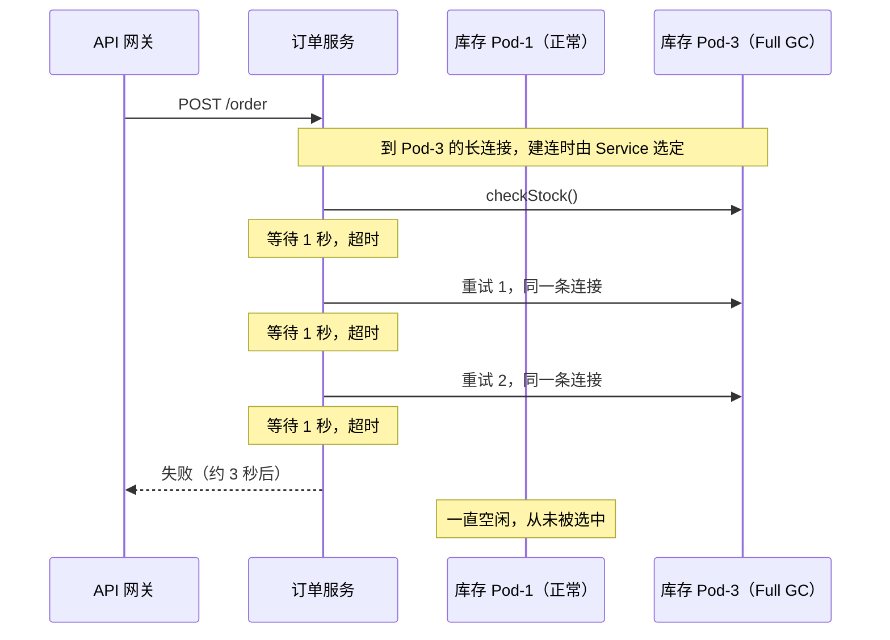
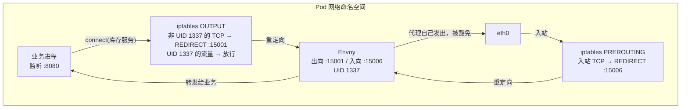
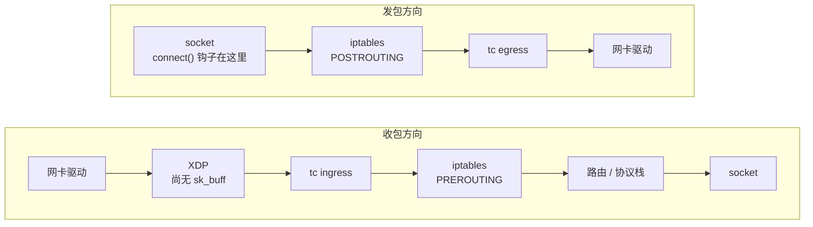
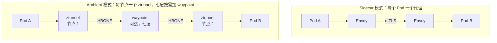

# 31. 微服务的流量治理：服务网格与 eBPF

网络层的工具有一个共同的前提：出问题的东西，得能被表达成包。链路断了是包不通，丢包是包没到，延迟是包慢了。可微服务之间有相当一部分故障，包是通的，到得也不慢，慢的是处理包的进程。

设想这样一次故障，库存服务有若干个 Pod，其中一个因为内存压力频繁 Full GC，每次停顿几秒。订单服务调库存的超时设成 1 秒，失败后重试 2 次，一个请求最多卡 3 秒就返回错误。基础设施的指标没有任何异常，下单失败的投诉却在上涨。最后是调用链追踪显示订单到库存这一跳的 P99 从几十毫秒涨到了秒级，怀疑才从网络挪到应用。

但有一个地方说不通，库存服务有好几个 Pod，只坏了一个，订单服务还会重试，为什么用户仍然失败？重试没起作用，只可能是三次尝试落在了同一个 Pod 上。那负载均衡为什么没有把它们分开？

## 31.1 请求落在哪个 Pod，是谁决定的

订单服务访问库存服务，通常写的是 Service 的虚拟地址。kube-proxy 在宿主机上用 iptables 或 IPVS 规则做 DNAT，把目的地址换成某个后端 Pod 的真实 IP。这个选择发生在连接建立的那一刻，此后这条连接上的所有包，都沿着已经记下的映射走向同一个 Pod。换句话说，它均衡的是连接，不是请求。

对 HTTP/1.1 来说，这个粒度基本够用。一条连接同一时刻只能跑一个请求，要并发就得多开连接，长连接又会被两端定期拆掉，连接自己在不停轮换，请求也就跟着摊开了。HTTP/2 和 gRPC 反过来：它的设计目标就是在一条长连接上多路复用所有请求。连接一旦建好，就再没有均衡可做，所有请求都被钉在同一个后端上。Kubernetes 社区早年有篇讲 gRPC 负载均衡的文章，开头就是这个现象：Service 背后有好几个 Pod，监控里却只有一个在干活，因为只有它在收流量。

回到开头的故障，订单服务到库存服务的连接复用得很彻底，一部分连接恰好钉在了那个 Full GC 的 Pod 上。1 秒超时之后重试，走的还是同一条连接，落回同一个 Pod，再等 1 秒，再重试。重试在这里没有换一次运气，只是把等待重复了三遍。

要让重试真正有用，均衡就得下沉到请求这一级：订单服务要同时和库存的每个 Pod 建立连接，每发一个请求，才挑一个当下状况最好的 Pod。这需要读懂 HTTP 帧，而安全组、路由表、Flow Log 都停在四层。

**图 31.1：一个请求为何三次都落在同一个 Pod**

这类调用的规模也让问题更难手工处理。一个中等规模的系统有 200 个服务、2000 个 Pod，每个用户请求触发 10 到 20 次内部调用，每秒 1 万个用户请求就是每秒 10 到 20 万次 Pod 之间的调用。南北向流量一路上有 CDN、WAF、负载均衡逐级把关，东西向流量在 VPC 内部直接流转，量更大，却没有这些关口。

要治理这些调用，需要的能力其实都很具体：按请求而非按连接做均衡，给每次调用设超时，失败了有节制地重试，持续出错的实例要能摘掉，新版本能按比例放量，每一跳的耗时能串成一条链。问题是这些逻辑放在哪里。

## 31.2 治理逻辑放在哪里

最直接的做法是写进业务代码，每个服务的开发者自己实现超时、重试和熔断。200 个服务各写各的，阈值不统一，策略不一致，运维团队也看不到全局的调用拓扑。

于是有了统一的 SDK，Spring Cloud、Dubbo 这一类框架把治理逻辑标准化，所有服务引入同一份配置。一致性问题解决了，新的问题随即出现。SDK 通常只支持一种语言，微服务系统里有三四种语言是常态，每种都要有功能等价的一套。SDK 修了 Bug，200 个服务要各自升级、重新编译、重新发布，半年后仍有相当一部分服务跑着旧版本，行为不一致比没有 SDK 时更难排查。

还有一层更隐蔽，超时和重试这类参数，是由写业务的人来配置的，而它们的局部最优与全局最优常常相反：给自己的下游调用多配几次重试，对这个服务是更稳，对下游却是更重的负载。后面讲到重试放大的时候，这个矛盾会变得很具体。

这些问题的共同根源，是治理逻辑和业务代码住在同一个进程里。语言绑定，因为 SDK 必须和业务用同一种语言；升级困难，因为两者打包成同一个二进制；职责混淆，因为两者共享同一个进程空间。

那就把治理逻辑从业务进程里彻底拿出来：在每个 Pod 旁边放一个独立的代理，通常是 Envoy，Pod 的进出流量都先经过它。代理看得懂 HTTP，能执行治理策略，也能记录每一次调用。业务代码不改一行，也不知道它的存在。这就是 Sidecar 模式。

## 31.3 Sidecar 如何接管流量

业务进程以为自己在直接连目标服务，是什么让流量先到了代理那里？答案是 iptables，而且发生在 Pod 自己的网络命名空间里。

Pod 启动时，一个初始化容器（或者 CNI 插件）在 Pod 的网络命名空间中写入 nat 表规则：业务进程发出的 TCP 流量在 OUTPUT 链上被 REDIRECT 到代理的出向监听端口 15001，从外面进来的流量在 PREROUTING 链上被 REDIRECT 到入向监听端口 15006。以 Istio 为例，初始化容器需要 `NET_ADMIN` 和 `NET_RAW` 权限，命名空间的 Pod 安全级别如果卡死在 baseline 或 restricted，它就跑不起来，这时要改用 Istio CNI 插件，把写规则的动作挪到节点级的组件里完成。

这里有一个绕不开的问题：代理自己发出的流量，会不会也被这条规则重定向回代理？会，而且会形成死循环。解法是让代理以一个固定的用户身份运行，重定向规则按进程的 UID 放行。Istio 里这个 UID 是 1337，官方文档要求业务容器不得使用它。规则的逻辑因此是两条：不是 1337 发出的，重定向给代理；是 1337 发出的，直接放行出站。

**图 31.2：Pod 内的流量劫持与 UID 豁免**

重定向之后，代理还要知道业务进程原本想连谁。内核做 REDIRECT 时把原始目的地址记了下来，代理通过 `SO_ORIGINAL_DST` 这个 socket 选项取出，再代替业务进程发起真正的连接。对业务进程而言，一切照旧。

拿到七层流量的代理，各自要有自己的配置：往哪里路由、超时多久、重试几次、哪些实例可用。2000 个代理的配置不可能手工维护，这是控制面的事。以 Istio 为例，Istiod 负责把高层的路由规则翻译成 Envoy 的配置并持续下发，同时充当证书颁发机构，给数据面的 mTLS（Mutual TLS，双向 TLS 认证）签发证书。数据面处理每个请求，控制面决定每个代理该知道什么，两者的故障域是分开的：控制面短暂失联，代理仍按手里的最后一份配置转发，只是不再更新。

## 31.4 接管之后：超时、重试与摘除

这时我们再看本章开始的故障中，Sidecar 在订单服务一侧是怎么处理的？

首先是均衡下沉到请求。订单服务的代理与库存服务的每个后端都保持着连接，每个请求单独选一个后端，不再受应用那条长连接的限制。其次，一个 Pod 持续出错，代理可以把它从可用列表里摘掉。Envoy 的离群检测就是这个机制：某个后端连续出现若干次 5xx、超时或连接失败，就被驱逐一段时间；每被驱逐一次，下次的驱逐时长递增，恢复之后再逐渐衰减。还有一个容易被忽略的参数，最大驱逐比例，它规定已被驱逐的实例占比超过多少就不再继续驱逐。这个上限存在，是因为整个集群一起出问题时，把所有后端都摘光，比留着几个半死不活的更糟。

重试是治理里最容易好心办坏事的一个环节。先看 Istio 的默认行为：未显式配置时，HTTP 请求默认重试 2 次，触发条件限定为连接失败、流被拒绝、服务不可用、503 这类明确的失败信号，请求超时默认是关闭的。这个默认值偏保守，是有道理的。可不少团队上线之后会手工加大重试次数，再把超时调短，觉得这样更稳。

重试放大的算术并不复杂。Google SRE 手册讲过：假设后端大面积拒绝请求，客户端每个请求最多尝试 3 次，请求量会放大到接近 3 倍。再叠加每个客户端的重试预算，限制重试请求占总请求的比例不超过 10%，放大一般能压到 1.1 倍。这是单层的情形。如果调用链有好几层，每层都自己重试，放大就是连乘。

**图 31.3：分层重试的放大效应（最坏情况）**

> 假设每层都最多尝试 3 次，且每次都失败。27 是按此条件的粗算，不是实测值。

数据库本来就已经撑不住，最底层收到的请求还是原来的 27 倍。SRE 手册的结论也在这里：重试只应当发生在紧邻失败层的上一层，其余各层应当把错误直接抛回去。靠每个业务团队自觉做到这一点很难，这就是代理层统一管理重试的价值，限制重试预算、统一退避，是基础设施才能保证的事。

超时同样需要统一。订单服务调库存的超时是 1 秒，库存服务再调自己的下游，超时也设成 1 秒，那么上游早已放弃、下游还在白忙。上游的超时必须大于下游包括重试在内的总耗时，沿调用链自上而下逐层变小，这是个全局约束，单个服务的开发者很难看到。

开头的那个 Full GC 的 Pod，就是这样被治理的：请求级均衡让大部分请求绕开它，离群检测在连续几次失败之后把它摘掉，重试因此更容易落到别的实例上。而重试的次数与预算，决定它在恢复期间不会反过来把剩下的几个 Pod 压垮。

可观测性也可以同时到，每个代理都记录经过它的每一次调用：源服务、目标服务、方法、路径、状态码、耗时，汇总起来就是完整的流量拓扑，每个服务的错误率和延迟分布一目了然。

代理能自动上报每一跳的 span，但要把它们串成一条链，需要请求头里携带的追踪上下文。代理看见一个入站请求和一个出站请求，并不知道后者是由前者触发的，把它们关联起来的只能是业务代码。Istio 的文档说得很直接：应用必须从每个入站请求中取出相关的头，转发给由它触发的所有出站请求，常见的有 `x-request-id`、`traceparent`、`tracestate`，使用 Zipkin 时还有一组 `x-b3-*`。所以“不改一行业务代码”只对拓扑、指标和访问日志成立，对完整的调用链，业务代码仍要负责透传。

还有一个要留意的地方，重试在业务上是否安全。订单服务除了查库存，还要调支付服务扣款、调通知服务发短信，代理看不见业务语义，它只知道这个请求失败了。对没有幂等保证的接口，盲目重试可能重复扣款、重复发短信。治理层可以按方法、按路径指定哪些接口允许重试，但接口本身是否幂等，只有业务知道。

## 31.5 Sidecar 的账单

Sidecar 的收益很清楚，但并非没有代价。

数据路径上，一次 Pod 到 Pod 的调用，流量要穿过两个代理。业务进程发出的数据先进内核，被 iptables 重定向，经过回环接口到达代理，代理在用户态读出、解析、套用策略，再通过另一条连接发出去；对端的代理对称地做一遍。每一跳多了两次经过回环接口的协议栈穿越，和两次用户态的读写。这和七层负载均衡的代价是同质的，代理必须终结连接再重新发起，调用链越长，这笔开销累加得越多。具体增加多少延迟，Istio 官方文档给的是不同请求速率下的 P90、P99 曲线，没有一个固定数字，结果取决于负载、协议和开启的功能。如果延迟预算紧，这个延迟值得在自己的集群里实测。

资源上，要分开看 CPU 和内存。Istio 1.24 官方的测试条件是每秒 1000 个请求、每个 1 KB，一个 Sidecar 大约占 0.20 个 vCPU 和 60 MB 内存。CPU 随流量增长，内存却主要随配置量增长：代理持有多少监听器、集群、路由，就占多少内存。默认情况下每个代理都被告知整个网格里的所有服务，网格越大，每个 Sidecar 越吃资源，所以官方建议在大规模场景下用配置范围限定，只给每个代理下发它真正会访问的那部分服务。

我们不妨用官方数据粗算一遍，2000 个 Pod 就是 2000 个 Sidecar，按 60 MB 算，内存约 120 GB。CPU 取决于总流量：每秒 10 到 20 万次调用，每次调用穿过两个代理，相当于每秒 20 到 40 万次代理处理，线性外推下来是几十个核。这是量级估计，且假设了流量均匀、功能开销不变。可见 Sidecar 的开销主要不在 CPU，而在内存和随网格规模膨胀的配置，这与“Sidecar 吃掉几百个核”的直觉并不一致。

运维上，Sidecar 与业务容器同生共死。它崩溃了，iptables 规则还在，Pod 的流量仍被重定向到一个没有进程在监听的端口，业务看到的是连接失败。升级 Sidecar 版本，要重启所有带它的 Pod，2000 个 Pod 的滚动重启，在谨慎的发布节奏下可能持续数小时。这不是配置得更好就能消除的，它由“代理住在业务 Pod 里”这个结构决定。

这三项代价有同一个来源：代理跑在用户态。每个包要从内核进到用户态，处理完再回到内核。如果决策能在内核里直接做完，这些穿越就不需要了。

## 31.6 eBPF：把决策点前移

eBPF 允许在内核的特定位置挂载自定义程序，由内核在包经过时执行。和网络相关的挂载位置有几处。

收包方向上，网卡驱动刚收到包时，内核还没为它分配 `sk_buff`，XDP 程序就跑在这里，是整个路径上最早的位置，也最受限，能看到的上下文很少。XDP 返回放行之后，内核才分配 `sk_buff`、做 GRO，然后到达 tc ingress。它位于任何协议处理之前，也早于 iptables 的 PREROUTING。发包方向正好相反：tc egress 在 iptables POSTROUTING 之后，是包交给网卡驱动前的最后一个位置。

这个顺序说明，tc 上的 eBPF 程序可以绕开 Netfilter 整套规则链，在 iptables 看到包之前就先处理完。

**图 31.4：eBPF 在收发包路径上的挂载位置**

最能说明 eBPF 价值的，是 Cilium 对 kube-proxy 的替代方式。kube-proxy 在包的路径上做 DNAT，每个包都要被改写目的地址，应答包再改回来。Cilium 把这个动作提前到了应用调用 `connect()` 的那一刻：一个挂在 cgroup 上的 eBPF 程序检查目的地址是不是某个 Service 的虚拟 IP，是的话直接选出一个后端，把 socket 的对端地址换成后端地址。应用以为自己连的是 Service，内核里的 socket 实际连的是后端，此后每个包本来就带着后端地址，不再需要额外的 NAT；`recvmsg` 和 `getpeername` 这类钩子再把地址还原给应用看。

这一步的意义在于决策点的位置变了：选后端发生在包还没有被构造出来的时候，而不是包已经在协议栈里走了一半之后。

这种做法和 Sidecar 之间有直接的冲突。Sidecar 的 iptables 规则依赖原始的目的地址来识别流量，socket 层一旦把 Service 地址改写了，代理就认不出这条流量原本要去哪个服务。Cilium 的文档专门为此留了一条退路：遇到 Istio 这类 Sidecar，可以关掉 Pod 命名空间内的 socket 层改写，退回到 veth 上的 tc 程序按包做负载均衡。两种机制在同一个 Pod 里争夺“谁来改目的地址”，这是混合部署时需要预先考虑的。

四层的能力，eBPF 做得很好：负载均衡、访问控制、连接统计，只看包头，决策可以在内核里一次做完，统计写进内核态的哈希表，用户态按需读取。也不需要为每个 Pod 起一个代理进程。

七层就不同了，mTLS 之后载荷是密文，tc 位置上的程序看不到 HTTP 请求。就算是明文，一个 HTTP 请求可能分散在多个 TCP 段里，头部变长，要先做流重组才能解析，而 eBPF 的校验器要在加载时证明程序一定会终止、不会越界，对循环和程序规模都有限制。重试和超时还要求把请求缓存起来、等待响应、必要时重发，这是代理才有的状态，不是对每个包执行一次的程序能承担的。校验器保证了安全，不会让内核崩溃，但它换来的是能力上的约束。

所以现实里的方案多是混合的。Cilium 的七层策略（HTTP 策略、Ingress、Gateway API）同样交给节点上的 Envoy 完成，每个节点一个共享的 Envoy，处理该节点上所有匹配的七层请求；四层仍由 eBPF 在内核里解决。

## 31.7 代理的位置：从每个 Pod 到每个节点

当四层被 eBPF 接走，七层要留给代理，那代理就不必每个 Pod 一个了。Istio 的 Ambient 模式是这个思路的一种完整实现，它把数据面拆成两层。

下层是 ztunnel，每个节点一个，以 DaemonSet 方式运行，只处理四层：mTLS、四层授权策略和 TCP 层面的遥测。Pod 之间的流量被透明地重定向到所在节点的 ztunnel，由它在源和目的之间建立加密隧道，协议叫 HBONE，本质上是基于 HTTP CONNECT 的隧道。上层是 waypoint 代理，按命名空间或服务按需部署，只在需要七层能力时才存在，负责 HTTP 路由、七层授权这类策略。没有部署 waypoint 的服务，流量只经过两端的 ztunnel。

**图 31.5：Sidecar 与 Ambient 的代理位置**

官方同一组测试条件下，ztunnel 每个实例约 0.06 个 vCPU、12 MB 内存，是节点级的，而不是每个 Pod 一份；waypoint 约 0.25 个 vCPU、60 MB。只需要 mTLS 和四层策略的服务，不再为七层能力付一次 Envoy 的成本。

这种拆分也在重新分配故障域，一个节点上所有 Pod 共用一个 ztunnel，它出了问题，影响整个节点。Cilium 的嵌入模式也有类似的特性，七层策略依赖节点上 Cilium agent Pod 的可用性。waypoint 不一定与源或目标在同一个节点，带七层策略的请求要经过两段 HBONE 隧道，多出一跳网络路径。Sidecar 把代理与业务绑在一起，换来的是故障隔离的清晰，这个优势随着代理的共享而丢掉一部分。

还有一点不要误读：Ambient 并没有让流量重定向消失。入站和出站的流量依然是被透明地重定向到 ztunnel，HBONE 的封装和加密发生在源 Pod 的网络命名空间里，只是执行这些的代理从 Pod 内的进程换成了节点级的组件。

## 31.8 三层访问控制

服务网格也能控制“订单服务能否调用库存服务”，安全组也在控制“谁能访问谁”。有了网格，安全组是不是多余？

两者的粒度不同，安全组只认 IP、端口和协议，它不知道什么是订单服务。微服务里 Pod 的 IP 是动态分配的，重启、扩容都会变，用安全组去表达服务级的访问关系，要频繁改规则，粒度也只到“IP 加端口”，分不出 GET 和 DELETE。网格的访问控制基于服务身份，身份来自证书，不随 IP 变化：订单服务可以调用库存服务的 `GET /stock`，不能调用 `DELETE /stock`。这里要注意，仅靠节点级的 ztunnel，只能做到四层的授权，细到 HTTP 方法和路径，需要有七层代理（Sidecar 或 waypoint）介入。

Kubernetes 的 NetworkPolicy 夹在两者之间。它按标签选择 Pod，由 CNI 插件翻译成宿主机上的 iptables 或 eBPF 规则，粒度到 Pod，但依然是四层的，只是不必再手工追踪 IP。

| 层次 | 判断依据 | 执行位置 | 能表达的策略 |
|---|---|---|---|
| 安全组 | IP、端口、协议 | VPC 数据面 | 子网之间、VPC 之间能否到达 |
| NetworkPolicy | Pod 标签（翻译为 IP 规则） | 宿主机内核，由 CNI 实现 | Pod 之间能否在四层连通 |
| 网格鉴权 | 服务身份、HTTP 方法与路径 | 代理（Sidecar 或 waypoint） | 谁能调用谁的哪个接口 |

有了网格仍然保留下两层，不是因为谁更高级，是因为网格的保护有边界。网格只管已经进入网格的工作负载。Istio 文档提到，直接用 Pod IP 访问，不会匹配到任何 Service，流量可能被透传，拿不到 mTLS、路由和遥测；ztunnel 默认同时接受 HBONE 和明文，要拦住明文，需要显式配置要求身份的策略。换句话说，网格的保护取决于配置是否严格，而下面两层不依赖这些配置。

反过来，网格自己也要在四层有通路。代理之间的 HBONE 隧道有专用端口，控制面向数据面下发配置有专用端口，安全组和 NetworkPolicy 配得太紧，网格自己先断了。

三层里没有哪一层能替代另一层。安全组回答网络上谁能到达谁，NetworkPolicy 回答集群里哪些 Pod 彼此可见，网格回答在已经到达的前提下，谁有资格调用什么。故障与攻击的路径各有不同，它们不会一起失效，这才是分层的理由。

再看开头的故障，网络层始终是绿的，这并不是工具坏了，是它们本来就只回答四层的问题。把治理逻辑一层层往下搬，是为了让回答更快、更统一；但越往内核靠，它越读不懂请求；越贴近应用，读得越懂，付的代价也越多。哪里是合适的位置，在这个系统里没有标准答案，只有在“看得懂”和“付得起”之间每次重新做的选择。
